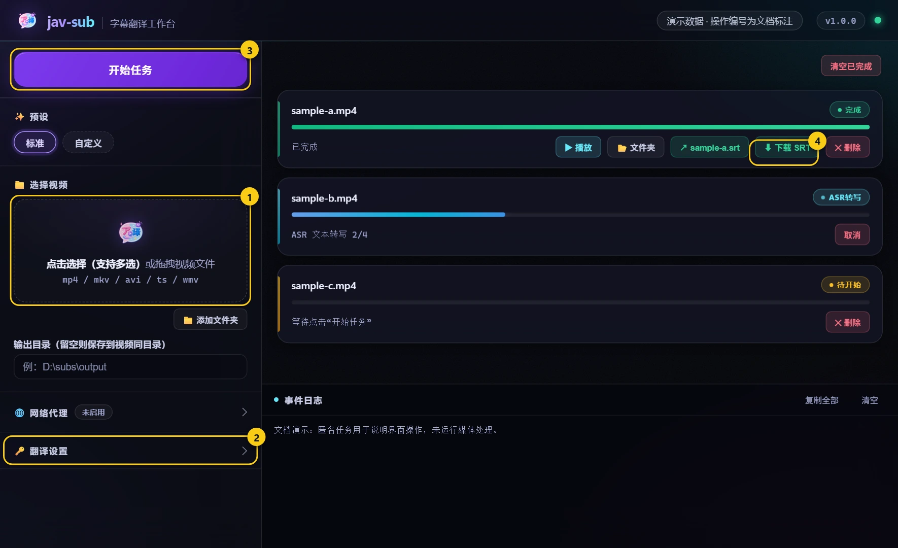
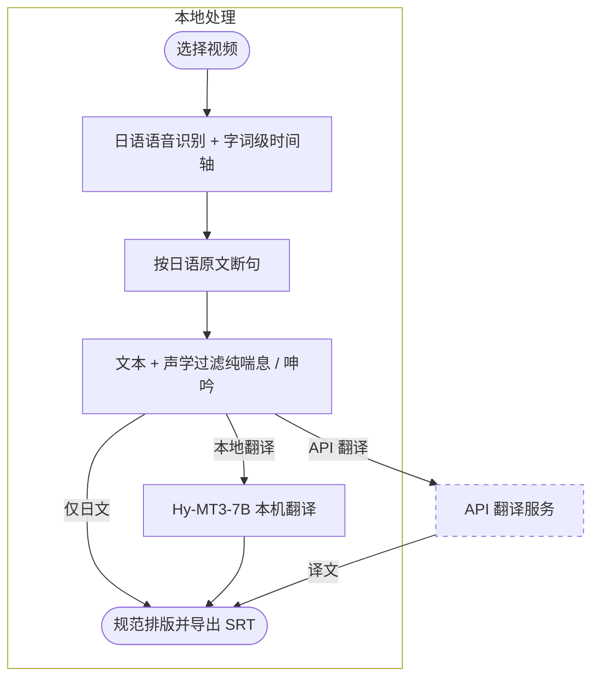

# jav-sub

**为日语视频一键生成日文、中文或双语 SRT 字幕。** 在本机桌面窗口选好视频，自动完成日语识别、时间轴对齐、翻译（本地或 API）与字幕排版导出。

[**⬇ 下载 Windows 发布包**](https://github.com/jaykwok/jav-sub/releases/latest/download/jav-sub-windows-x64.zip) · [版本说明](https://github.com/jaykwok/jav-sub/releases/latest) · [快速开始](#快速开始) · [翻译模式](#选择翻译模式) · [升级](#升级到新版本) · [常见问题](#常见问题)

> **适用环境**：Windows 10/11 + NVIDIA 显卡（≥ 8 GB 显存）。字幕默认保存到视频所在目录。



*标准模式操作示意（①–④ 为步骤标注，界面中的任务与进度为演示数据；点击可查看大图）。*

---

## 运行要求

| 项目 | 要求 |
| --- | --- |
| **系统** | Windows 10 / 11（64 位） |
| **显卡** | NVIDIA 独立显卡，至少 **8 GB 物理显存**（需支持 CUDA，不回退 CPU） |
| **磁盘** | 解压到普通可写目录（勿放 `C:\Program Files`），预留约 **17 GB** 空间 |
| **网络** | 首次安装依赖与下载模型需联网（建议准备代理）；API 翻译全程需联网 |

**速度参考**：在 RTX 4060 Ti 8 GB 上处理一段约 1 小时 50 分钟、266 条字幕的视频，语音识别与对齐约 9 分钟，本地翻译（Hy-MT3-7B Q4 · CUDA）约 30–50 秒（不含首次下载）。

<details>
<summary><strong>首次运行会自动下载什么？占用多大空间？</strong></summary>

发布包本身约 100 MB（含启动器、源码、依赖锁与 FFmpeg Shared），其余组件按需自动准备：

| 组件 | 准备方式 | 约占空间 |
| --- | --- | --- |
| FFmpeg Shared | 已内置在发布包 `bin\` 目录，无需安装 | 已含 |
| Python、PyTorch 等运行环境 | 首次双击启动自动安装（`uv` 缺失时自动从 PyPI 获取） | ~3.3 GB |
| 语音识别模型与 CTC 对齐头 | 首次转录自动下载到 `models\` | ~3.9 GB |
| 本地 CUDA `llama-server` | 首次启动默认在后台自动下载到 `models\runtime\llama-cpp\` | ~226 MB |
| 本地翻译模型（Hy-MT3-7B Q4） | 首次本地翻译自动下载到 `models\` | ~4.8 GB |

下载或安装中途中断后，重新双击 `jav-sub.exe` 会自动续传或复用已完成部分，无需从头再来。

</details>

---

## 快速开始

1. **下载并启动**：下载 [`jav-sub-windows-x64.zip`](https://github.com/jaykwok/jav-sub/releases/latest/download/jav-sub-windows-x64.zip)，解压到普通文件夹后双击 `jav-sub.exe`。首次启动会测速并询问代理，随后自动装好依赖并打开窗口。
2. **添加视频（①）**：点击左侧 **选择视频**（支持多选、拖拽或添加文件夹）。输出目录留空则直接保存在视频同目录；初次使用建议先用短视频测试。
3. **配置翻译（②）**：默认已启用 **本地翻译**（零配置、免费离线，目标语言默认简体中文），可直接开始任务；如需改用 **API 翻译** 或添加术语表，展开 **翻译设置** 修改并保存即可。
4. **开始并获取字幕（③ → ④）**：点击 **开始任务**；完成后在任务卡直接 **播放**、**打开文件夹** 或 **下载 SRT**。

> 标准预设默认输出 **仅译文字幕**。如需 **双语** 或 **仅日文**，见 [自定义选项](#自定义选项)。

---

## 选择翻译模式

| 模式 | 额外准备 | 费用与说明 | 适用场景 |
| --- | --- | --- | --- |
| **本地翻译（默认 · 推荐新手）** | 无（自动下载 CUDA 引擎与模型） | 免费 · 离线运行 | 开箱即用、不想配 API |
| **API 翻译** | 支持 Responses 接口的 Key | 按量计费 · 需联网 | 追求更强整片上下文与人名消歧 |
| **仅日文** | 在「自定义」中开启不翻译 | 免费 · 完全离线 | 只需要日文 SRT 或暂不翻译 |

### 本地翻译（默认 · Hy-MT3-7B Q4 · 自动部署）

1. 默认已选中 **本地翻译（Hy-MT3-7B Q4 · llama.cpp）**，无需额外配置即可直接开始任务；如需调整目标语言或术语表，展开 **翻译设置** 修改后点击 **保存翻译设置**。
2. 若 `./models/runtime/llama-cpp/` 尚未准备，启动程序后会自动在后台下载匹配本机 CUDA 版本的 `llama-server`；首次本地翻译时会自动下载 `Hy-MT3-7B-Q4_K_M.gguf`（约 4.8 GB）。

无需手动安装 `llama.cpp` 或填写路径。本地翻译按显卡显存自动适配上下文与并发槽位，支持自定义术语表；7B 模型对省略主语的复杂句偶有误判，重要字幕建议复查。离线覆盖与参数调优见 [本地翻译配置](docs/ADVANCED.md#本地翻译)。

### API 翻译（OpenAI 兼容）

1. 在 **翻译设置 → 翻译后端** 中选择 **API 调用（OpenAI 兼容）**。
2. 填写 **API Key**（默认 OpenRouter；换其他服务商时同步填写 Base URL 并保存）。
3. 点击模型旁的 **获取** 选择对应模型，确认目标语言与推理强度后保存。

> 所选服务必须支持 **Responses 接口（`/responses`）**，仅支持 Chat Completions 的端点不可用。常见端点配置见 [API 翻译](docs/ADVANCED.md#api-翻译)。

---

## 自定义选项

点击左侧 **自定义** 并展开 **参数调优** 即可按需调整，调好后可点 **保存自定义任务模板** 记住偏好（切回 **标准** 即恢复默认）：

| 需求 | 设置方法 |
| --- | --- |
| **仅日文字幕** | 开启「不翻译（仅日文字幕）」，无需配置翻译 |
| **双语字幕** | 关闭「不翻译」，在「字幕模式」选择双语（日文在上、译文在下） |
| **调整翻译并发** | 修改「并行翻译 Worker 数」（默认 `4`，遇到 API 限速可调低） |

三种输出（仅日文、仅译文、双语）共用同一条日文时间轴，中/日双轨分别按 Netflix 字幕规范排版（每轨最多 2 行），字体与样式由播放器决定。

---

## 工作原理



- **字幕与日志放哪了？** 导出到所选输出目录（默认视频同目录）：仅日文为 `sample-a.ja.srt`，译文/双语为 `sample-a.srt`；`outputs/` 保存每次已提交的正式产物（含 SRT、双语 JSON 与该任务 `.run.log`），`logs/` 保存进程与任务排错日志，设置与 API Key 保存在独立的 `config/config.json`，`tmp/` 仅存一次性临时文件（失败任务会保留提取音频便于复现）。
- **哪些操作会联网？** 首次安装依赖与模型下载；发布版启动时默认检查一次 GitHub 最新稳定版（可在顶部版本号弹窗中关闭）；使用 API 翻译时调用所选接口。
- **中断能否续跑？** 可以。已完成的识别与翻译缓存会自动复用；若仅保存或导出失败，在任务卡点重试即可，无需重新识别翻译。

目录说明与恢复细节见 [结果与恢复](docs/ADVANCED.md#结果与恢复)。

---

## 升级到新版本

### 方式一：在线一键升级（推荐）

发布版启动时默认会在后台检查一次 GitHub 最新稳定版（忽略预发布版；可在右上角版本号弹窗中取消勾选「启动时自动检测新版本」关闭，不影响手动检查）：

1. 检测到新版本后，界面右上角版本号会高亮提示 **↑ 新版本**；点击打开更新弹窗即可查看版本说明。
2. 等待当前任务结束并关闭同目录的其他程序窗口后，点击 **立即升级**。
3. 程序会自动下载更新包、校验完整性并覆盖安装，同时清理升级临时缓存与旧启动器备份，完成后自动重启进入新版本。

也可在程序目录打开 PowerShell 运行命令行在线升级：

```powershell
.\jav-sub.exe --update
```

### 方式二：手动下载 ZIP 覆盖（离线备用）

1. 关闭程序窗口。
2. 打开新版压缩包，进入里面的 `jav-sub` 文件夹，将全部内容复制到旧版程序目录并选择 **替换同名文件**（或解压到旧版 `jav-sub` 的上一级目录）。
3. 双击 `jav-sub.exe`：若依赖有更新会自动增量同步。

> 无论在线升级还是手动覆盖，`.venv`、`.python\`、`models\`、`config\`、`outputs\`、`cache\` 和已导出字幕均自动保留；旧版不再使用的程序文件会自动移入 `tmp\upgrade-leftovers\`。
>
> **注意**：手动覆盖时不要把压缩包里的 `jav-sub` 文件夹整层塞进旧版文件夹内，否则会形成嵌套目录导致重新下载。

---

## 常见问题

| 现象 | 解决方法 |
| --- | --- |
| 程序打不开或环境异常 | 在程序目录运行 `.\jav-sub.exe --doctor` 自检修复，见 [启动与下载](docs/ADVANCED.md#启动与下载) |
| 下载慢或连接超时 | 在左侧「网络代理」填写代理并点测试，或启动加 `--proxy`，见 [启动与下载](docs/ADVANCED.md#启动与下载) |
| CUDA 不可用或显存不足 | 关闭占显存的程序、更新 NVIDIA 驱动（需 ≥ 8 GB 显存），见 [显卡与取消](docs/ADVANCED.md#显卡与取消) |
| API 报错或模型不可用 | 检查 Key、Base URL 与 Responses 接口支持，见 [API 翻译](docs/ADVANCED.md#api-翻译) |
| 译文有明显偏差 | 本地 7B 误判可添加术语表或改用 [API 翻译](#api-翻译openai-兼容) |
| 卡在「停止中」或提示 GPU 未释放 | 按顶部提示条等待清理，必要时点「重新检查」或「重试清理」，见 [显卡与取消](docs/ADVANCED.md#显卡与取消) |
| 保存 / 提交 / 导出失败 | 点击任务卡上的对应重试按钮，不会重复识别和翻译，见 [结果与恢复](docs/ADVANCED.md#结果与恢复) |
| 升级后重新下载模型 | 检查是否把新版嵌套解压进了旧目录内部，按 [升级到新版本](#升级到新版本) 重新覆盖 |

---

## 更多文档与开发

使用 Windows 发布包时无需配置开发环境；开发者从源码运行（Git + `uv` + FFmpeg Shared）见 [从源码运行](docs/ADVANCED.md#从源码运行)。

- [进阶设置与排错](docs/ADVANCED.md) · [配置校验规则](docs/ADVANCED.md#配置校验) · [反馈问题清单](docs/ADVANCED.md#反馈问题)
- [模型目录说明](models/README.md) · [打包与发布说明](packaging/README.md)

致谢：[WhisperJAV](https://github.com/meizhong986/WhisperJAV) 为本项目早期路线提供了重要参考。
